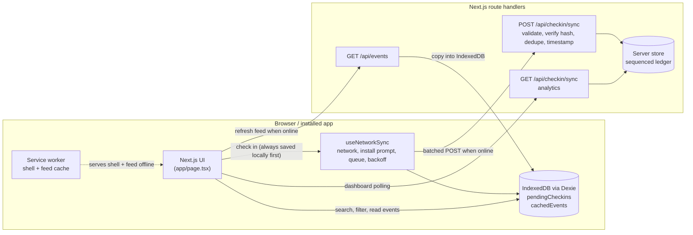
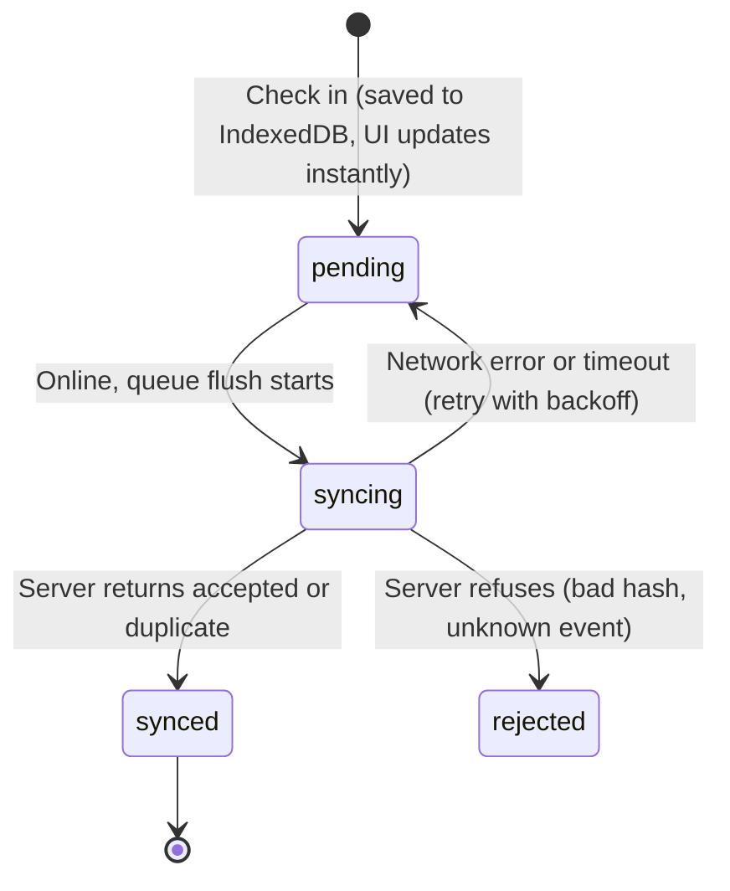

# EventSync India — Tech & Campus Events

**An installable, offline-first event app for Indian students and developers. Discover hackathons and fests, and check in even when the Wi-Fi dies.**

Built solo in 24 hours for the **Grevix AfterCode** hackathon.

Indian campus fests, SIH rounds and community meetups share one failure mode: a few hundred people reach the gate at once, the network collapses, and check-in records get lost or duplicated. EventSync treats the network as optional. Every check-in is saved on the device first and delivered to the server exactly once when a connection exists.

> Event names follow real Indian formats (Unstop hackathons, SIH, AWS Community Day, college fests), but dates, venues, fees, organizers and attendance numbers in the demo catalogue are illustrative placeholders, not live listings.

---

## At a glance

|                              |                                                                                                                                                                          |
| ---------------------------- | ------------------------------------------------------------------------------------------------------------------------------------------------------------------------ |
| **Installable PWA**          | Web manifest, maskable icons, service worker and an in-app **Install App (APK)** button.                                                                                 |
| **Built for India**          | Fees in ₹ (INR, `en-IN` grouping), all times in IST, `.ics` exports with the `Asia/Kolkata` time zone, region filters for Mumbai / Pune, Bengaluru and Virtual / Global. |
| **Offline challenge solved** | Optimistic check-in, IndexedDB queue (Dexie), idempotent batch sync, timestamped server ledger.                                                                          |
| **Organizer view**           | Server-verified vs. pending attendance, conversion rate, registration fees in ₹, and a ledger that flags check-ins that came through an offline queue.                   |

---

## PWA installability

EventSync meets Chrome's installability criteria: a valid `manifest.json` (192 and 512 px icons plus a maskable icon, `display: standalone`, `start_url: /`), a service worker with a fetch handler, and HTTPS (or `localhost`).

- **Install button:** the app captures Chrome's `beforeinstallprompt` event (an inline script in `app/layout.tsx` grabs it before React loads) and shows **Install App (APK)** in the top bar. One tap opens the native install dialog. After install, the button is replaced by an _Installed_ badge (`appinstalled` event and `display-mode: standalone` detection).
- **What "APK" means here:** on Android, Chrome installs a PWA as a **WebAPK**: it appears in the app drawer and system settings like any other app, with no Play Store and no separate APK file to build. If you ever need a store-ready `.apk`/`.aab`, wrap the same deployed URL with [Bubblewrap](https://github.com/GoogleChromeLabs/bubblewrap) or [PWABuilder](https://www.pwabuilder.com/).
- **Home-screen shortcuts:** long-press the installed icon for _Offline Check-In Terminal_ and _Organizer Dashboard_ (`/?tab=checkin`, `/?tab=dashboard`).
- **iOS:** Safari has no install prompt. Use _Share, then Add to Home Screen_. The app already ships the Apple touch icon and standalone meta tags.

**Service worker strategy (`public/sw.js`)**

| Request                          | Strategy                                                                                                                                    |
| -------------------------------- | ------------------------------------------------------------------------------------------------------------------------------------------- |
| App shell: pages, JS, CSS, icons | Precached on install, then stale-while-revalidate, so the installed app opens offline.                                                      |
| Page navigations                 | Network first (3 s timeout), falling back to the cached shell.                                                                              |
| `GET /api/events` (event feed)   | Network first (4 s timeout), falling back to the last cached response. If that is missing too, the page reads its **Dexie/IndexedDB** copy. |
| `/api/checkin/sync`              | Never intercepted. The app owns retries and deduplication.                                                                                  |

The service worker is registered in **production builds only**, so development never serves stale chunks.

---

## Architecture



### Check-in lifecycle



---

## The Offline Challenge Card: how it was solved

| Problem at real events                                           | What EventSync does                                                                                                                                                                                                                                      |
| ---------------------------------------------------------------- | -------------------------------------------------------------------------------------------------------------------------------------------------------------------------------------------------------------------------------------------------------- |
| Attendee taps _Check in_ and the request hangs                   | The check-in is written to IndexedDB first. The pass appears instantly (**optimistic UI**).                                                                                                                                                              |
| Connection drops mid-sync                                        | Each batch is marked `syncing` and returns to `pending` on failure. Nothing is deleted until the server confirms. 10 s request timeout plus exponential backoff (3 s up to 60 s).                                                                        |
| Retries create duplicate attendance                              | Each check-in carries a deterministic **idempotency key** (`event + email`). The server dedupes on that key and on the person-per-event pair, so replays, second tabs and second devices never double count. A unique local index stops double taps too. |
| Browsing is useless offline                                      | Events are mirrored into IndexedDB. Search, region/category/mode filters and `.ics` export run entirely on the client. The service worker keeps the app itself loading.                                                                                  |
| Organizers can't separate real attendance from queued attendance | The dashboard splits **server-verified** from **pending** and shows the conversion rate both ways.                                                                                                                                                       |
| Late records are indistinguishable from live ones                | The server's **timestamped ledger** stores the device check-in time, the server receipt time, a strictly increasing sequence number and the delay between them. Records that waited 60 s or more are labelled _queued offline_.                          |
| Forged or corrupted tickets                                      | Each ticket has a SHA-256 hash over `eventId, email, timestamp, key`. The server recomputes it and rejects mismatches.                                                                                                                                   |
| Demos depend on venue Wi-Fi                                      | **Simulate outage** forces offline behaviour on demand, alongside the real `online` / `offline` events.                                                                                                                                                  |

### Two-minute demo

1. **Discover Events:** tap _Mumbai / Pune_, search `unstop` or `web3`, then **Add to calendar** on an event. The `.ics` opens in IST.
2. Turn **Simulate outage** on. The bar turns amber. Search and filters keep working.
3. **Offline Check-In Terminal:** use _Fill demo attendee_ and check in three people. Passes appear instantly as _Saved on device_, and the bar shows _3 waiting to sync_.
4. **Organizer Dashboard:** verified is `0`, pending is `3`.
5. Turn the simulator off. The queue flushes automatically, passes become _Verified by server_, and the ledger shows each entry as _queued offline_ with its delay.
6. On Chrome, tap **Install App (APK)** (production build) and open it from the home screen or app drawer.
7. Idempotency check, run twice:

```bash
# "weak-" hashes (sent by devices without WebCrypto) are accepted but flagged unverified, which keeps this demo simple.
curl -X POST http://localhost:3000/api/checkin/sync \
  -H "Content-Type: application/json" \
  -d '{"checkins":[{"idempotencyKey":"chk_evt-grevix-aftercode_demo@example.com","eventId":"evt-grevix-aftercode","attendeeName":"Demo User","attendeeEmail":"demo@example.com","checkedInAt":"2026-01-01T09:00:00.000Z","ticketHash":"weak-demo"}]}'
```

The first call returns `accepted`, the second returns `duplicate`.

---

## Features

- **Connectivity bar:** live status from `navigator.onLine` and `online` / `offline` events, simulator toggle, pending counter, **Force Sync**, **Install App (APK)**.
- **Discovery:** region chips (**All India**, **Mumbai / Pune**, **Bengaluru**, **Virtual / Global**), category and mode filters, multi-term search over title, tags, description, city and platform.
- **India-first details:** ₹ fees ("Free", ₹50, ₹200, ₹400), IST times everywhere, state/region on each card, registration platform (for example Unstop).
- **Calendar export:** RFC 5545 `.ics` with a `VTIMEZONE` for `Asia/Kolkata`, fee and platform in the description, and a 30-minute reminder.
- **Check-in terminal:** optimistic UI, QR pass (`qrcode.react`) with a timestamped SHA-256 ticket hash, background sync in batches of 50, confetti on success.
- **Organizer dashboard:** verified vs. pending, conversion rate, registration fees in ₹, per-event table, live ledger with offline-delay labels, last-known figures when offline.
- **Accessibility:** labelled controls, ARIA tabs and switch roles, visible focus, `prefers-reduced-motion` respected, pinch-zoom left enabled.

## Tech stack

| Layer              | Choice                                                  |
| ------------------ | ------------------------------------------------------- |
| Framework          | Next.js 14 (App Router), TypeScript                     |
| Styling            | Tailwind CSS, `clsx`, Lucide React                      |
| Offline storage    | Dexie.js (IndexedDB)                                    |
| State              | Custom hook `useNetworkSync`                            |
| PWA                | Web App Manifest, service worker, `beforeinstallprompt` |
| Effects and passes | `canvas-confetti`, `qrcode.react`                       |

## Project structure

```
app/
  api/checkin/sync/route.ts   POST batched check-ins (dedupe, hash check, sequenced ledger), GET analytics
  api/events/route.ts         Event feed
  layout.tsx                  Manifest link, viewport/theme tags, install-prompt capture
  globals.css
  page.tsx                    Top bar, Discover, Offline Check-In Terminal, Dashboard, IST .ics utility
hooks/
  useNetworkSync.ts           Connectivity, install prompt, queue counts, batch sync with backoff
lib/
  db.ts                       Dexie schema, types (feeInINR, stateRegion, mode), Indian seed events
  serverStore.ts              In-memory server store (swap for a database)
public/
  manifest.json               PWA manifest
  sw.js                       Service worker
  icons/                      192, 512, maskable 512, Apple touch icon, favicon
```

## Setup

Requires Node.js 18.18 or newer.

```bash
npm install
npm run dev          # http://localhost:3000, fast development (no service worker)
```

To test installability and offline reload, use a production build:

```bash
npm run build
npm start
```

Open it in Chrome (on `localhost`, or on HTTPS when testing from a phone). After the first load, the **Install App (APK)** button appears in the top bar. To test offline, load the page once online, switch DevTools to _Offline_ and reload.

## API

### `POST /api/checkin/sync`

```jsonc
// request
{ "checkins": [{ "idempotencyKey": "...", "eventId": "...", "attendeeName": "...",
                 "attendeeEmail": "...", "checkedInAt": "ISO-8601", "ticketHash": "sha256-hex" }] }

// response
{ "results": [{ "idempotencyKey": "...", "status": "accepted | duplicate | rejected", "reason": "..." }],
  "accepted": 1, "duplicates": 0, "rejected": 0, "serverTime": "ISO-8601" }
```

Up to 200 check-ins per request. Each item gets its own result, so one bad record never blocks the rest of the batch.

### `GET /api/checkin/sync`

Returns totals (registrations, verified, conversion rate, registration fees in ₹), a per-event breakdown, and the latest ledger entries with `seq`, `checkedInAt`, `receivedAt`, `delaySeconds` and `offlineQueued`.

## Known limitations and roadmap

- The server store is **in memory**, so verified attendance resets when the server restarts. `lib/serverStore.ts` is the single seam to replace with Postgres, SQLite or Redis.
- No authentication yet. Next: organizer sign-in, HMAC-signed tickets so the server can prove it issued a pass, and role-based dashboard access.
- A staff-side QR scanner view would complete gate entry.
- Fee totals are computed from registration counts; there is no payment integration (UPI/Razorpay would be the natural next step).
- Install prompts are Chromium-specific. Safari uses _Add to Home Screen_.

## License

MIT
